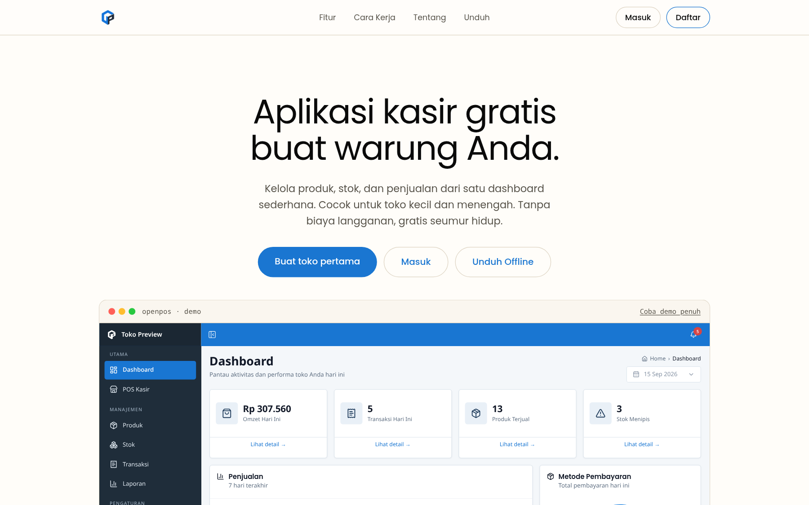
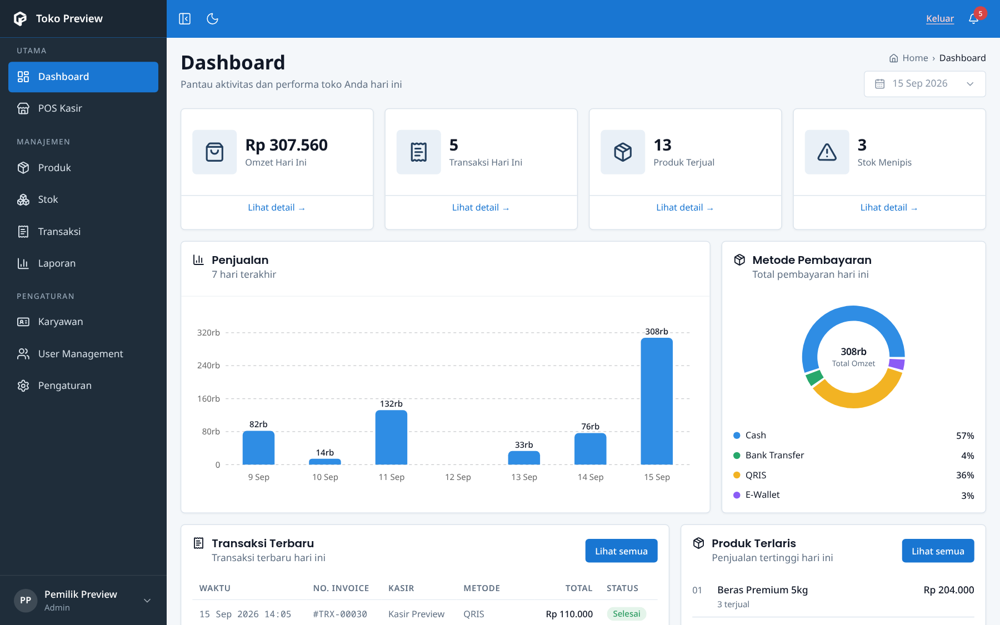
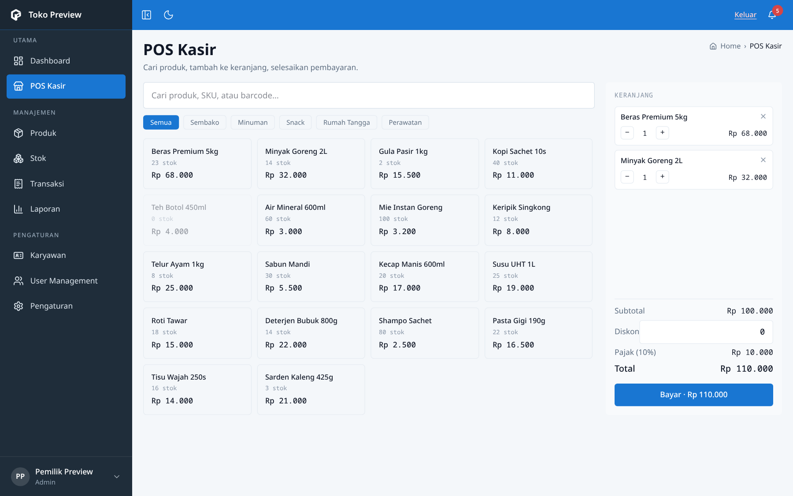

<p align="center">
  
</p>

<h3 align="center">Free point-of-sale for Indonesian small businesses.</h3>

<p align="center">
  <a href="LICENSE"></a>
  
  
  
  
  <a href="AWARD.md"></a>
</p>

<p align="center">
  <a href="https://open-pos-deploy.vercel.app"><strong>Live demo</strong></a>
  ·
  <a href="https://open-pos-deploy.vercel.app/unduh">Download (Windows, Linux &amp; Android)</a>
  ·
  <a href="https://github.com/0xMinomus/OpenPOS/releases">All releases</a>
  ·
  <a href="https://github.com/adrr-dev/openPOS">Backend API</a>
</p>

---

## Table of contents

- [About](#about)
- [Award](#award)
- [Screenshots](#screenshots)
- [Features](#features)
- [Tech stack](#tech-stack)
- [Getting started](#getting-started)
  - [Prerequisites](#prerequisites)
  - [Environment variables](#environment-variables)
  - [Run the web app](#run-the-web-app)
  - [npm scripts](#npm-scripts)
  - [Build the desktop app](#build-the-desktop-app)
  - [Build the Android app](#build-the-android-app)
- [Project structure](#project-structure)
- [Backend API](#backend-api)
- [Contributing](#contributing)
- [Code of Conduct](#code-of-conduct)
- [Security](#security)
- [License](#license)

## About

OpenPOS is a free, web-based point-of-sale system for Indonesian MSMEs (*UMKM*).
It covers the daily workflow of a small retail store end to end: cashier
checkout, product catalog, stock control, transaction history, sales reports,
and staff management, in Indonesian, with Rupiah formatting throughout.

One codebase in the `web/` workspace ships three products:

| Product | Data | Distribution |
|---|---|---|
| **Cloud web app** | Go + PostgreSQL REST API | Vercel, deploys automatically on every push to `main` |
| **OpenPOS Desktop** | Device-local, works fully offline | Tauri 2: Windows installer and Linux `.deb`/`.rpm`/AppImage from [GitHub Releases](https://github.com/0xMinomus/OpenPOS/releases) |
| **Android app** | Device-local, works fully offline | Sideloaded APK from the [Downloads page](https://open-pos-deploy.vercel.app/unduh) |

The cloud app is the reference implementation: multi-account stores,
role-based access, email OTP, and Google sign-in. OpenPOS Desktop and the
Android build reuse the same UI against a local adapter, so they trade
multi-device sync for working without internet.

OpenPOS Desktop is the Tauri app in `web/src-tauri/` built from
`web/offline-lite.html`; see [web/DESKTOP.md](web/DESKTOP.md) for its build and
packaging guide. The older Electron build in `web/electron/` stays in the
repository as a legacy Windows desktop version and is not the desktop release.

## Award

OpenPOS won **1st place in the National Web Competition** organized by
**Invention, Universitas Udayana**. See [AWARD.md](AWARD.md) for details.

## Screenshots

<p align="center">
  
</p>

| Dashboard | POS |
| --- | --- |
|  |  |

## Features

- **Role-aware dashboard**, owners see omzet, 7-day sales chart, payment mix,
  and top products; cashiers see only their own numbers.
- **Cashier POS**, server-side catalog, cart with effective stock, discounts,
  tax, five payment methods, exact-cash shortcut, and thermal receipts
  (58/80 mm).
- **Products & categories**, full CRUD, server-side search, CSV import/export.
- **Inventory**, current stock plus a complete adjustment history with reasons.
- **Transactions**, search, date and payment-method filters, refunds, CSV
  export. Times always come from `created_at`.
- **Reports**, sales, product, profit, stock, and staff tabs across five
  periods, with CSV export.
- **Staff management**, PIN-protected sub-accounts, fast account switching,
  online/offline presence via heartbeat, activity feed, and per-day top
  cashiers.
- **Admin notifications**, low-stock, out-of-stock, and cashier-sale events
  with category tabs and read tracking.
- **Authentication**, email + password with email-OTP second factor, Google
  sign-in, 5-digit admin/cashier passcodes, per-tab sessions with silent token
  refresh, and self-service password reset via email OTP.
- **Store settings**, identity, hours, receipt layout, and tax (inclusive or
  exclusive, configurable rounding, WIB/WITA/WIT time zones).
- **Offline backup** (desktop and Android builds), export and restore of the
  local database.

## Tech stack

| Layer | Technology |
|---|---|
| UI | React 19, TypeScript 6, Tailwind CSS v4, shadcn/ui on Base UI, Recharts, lucide-react, Poppins |
| Web tooling | Vite 8, React Router 8, oxlint |
| Desktop | Tauri 2 (Rust shell), Windows WebView2 and Linux WebKitGTK; NSIS, deb, rpm, AppImage bundles |
| Legacy desktop | Electron 44 + electron-builder (NSIS installer) |
| Mobile | Capacitor 8 (Android), same offline bundle, sideloaded APK |
| Backend | Go (Gin + GORM), PostgreSQL, JWT, separate repo: [adrr-dev/openPOS](https://github.com/adrr-dev/openPOS) |
| Hosting | Vercel (frontend auto-deploys on every push to `main`) |

## Getting started

### Prerequisites

| Requirement | Needed for |
|---|---|
| Node.js 22.12+ and npm | Everything: dev server, builds, Capacitor sync |
| Rust stable (`rustup`) | `npx tauri build` for OpenPOS Desktop |
| Windows x64, or Linux with WebKitGTK 4.1/GTK3 | OpenPOS Desktop installers and Linux packages; full dependency list in [web/DESKTOP.md](web/DESKTOP.md) |
| Android SDK Platform 36 (compile/target SDK 36, min SDK 24) and JDK 21 | `npm run mobile:sync`, Gradle build, `adb install` |

### Environment variables

Create `web/.env.local` (gitignored):

```bash
VITE_API_URL=https://openpos-api.vercel.app/api/v1
VITE_GOOGLE_CLIENT_ID=your-google-oauth-client-id
```

| Variable | Required | Purpose |
|---|---|---|
| `VITE_API_URL` | Yes | Base URL of the backend REST API. The dev server proxies `/api` to `http://localhost:8080`. |
| `VITE_GOOGLE_CLIENT_ID` | For Google sign-in | OAuth client ID; the frontend origin must also be registered in Google Cloud Console. |

Only `VITE_*` variables reach the client bundle. The offline builds ignore
both variables; they read device-local data instead.

### Run the web app

```bash
git clone https://github.com/0xMinomus/OpenPOS.git
cd OpenPOS/web
npm install
npm run dev      # local dev server (proxies /api to http://localhost:8080)
```

### npm scripts

All commands run inside `web/`:

| Command | Result |
|---|---|
| `npm run dev` | Vite dev server |
| `npm run build` | Type-check (`tsc -b`) + cloud bundle in `dist/` |
| `npm run build:lite` | Desktop frontend bundle in `dist-lite/` (internal historical name) |
| `npm run lint` | oxlint |
| `npm run build:offline` | Offline bundle in `dist-offline/` |
| `npm run electron:smoke` | Legacy Electron: headless render test of the offline app |
| `npm run electron:build` | Legacy Electron: cloud + offline builds, then the Windows installer in `release-out/` |
| `npm run mobile:sync` | Offline build + Capacitor sync for Android |

### Build the desktop app

OpenPOS Desktop is the Tauri app; the full guide lives in
[web/DESKTOP.md](web/DESKTOP.md). Script and output names still use the
historical "lite" label (`build:lite`, `dist-lite`, `offline-lite.html`).

Windows installer — from `web/`:

```bash
cd web
bash scripts/lite-build.sh      # native Windows build, or cross-compile from Linux
# or call the Tauri CLI directly
npx tauri build --bundles nsis
```

`lite-build.sh` copies the installer to `web/release-out-lite/`; a direct
`npx tauri build` leaves it under `web/src-tauri/target/.../bundle/nsis/`.
Linux packages:

```bash
cd web
npx tauri build --target x86_64-unknown-linux-gnu --bundles deb,rpm,appimage
```

Publish the Windows installer and the Linux `.deb`/`.rpm`/AppImage to
[GitHub Releases](https://github.com/0xMinomus/OpenPOS/releases); the
[Downloads page](https://open-pos-deploy.vercel.app/unduh) links Windows to the
newest release that carries an `.exe` asset.

The legacy Electron desktop build is still available and Windows-only:

```bash
cd web
npm run electron:build          # legacy installer → release-out/
```

Older Electron installers (`OpenPOS.Setup.<version>.exe`) and the first
OpenPOS Desktop releases remain published on GitHub Releases. Existing release
tags and asset filenames keep the older `lite` label and are not renamed.

### Build the Android app

```bash
cd web
npm run mobile:sync
cd android
./gradlew assembleDebug
adb install -r app/build/outputs/apk/debug/app-debug.apk
```

Release APKs are signed with a private keystore. Back it up: losing it
permanently breaks update continuity for installed users. Sideloaded APK
updates are manual by design, and the finished APK is published to
`web/public/openpos.apk` so the Downloads page can serve it.

## Project structure

```text
.
├── web/                    # the entire product (Vite workspace, npm root)
│   ├── src/
│   │   ├── pages/          # cloud routes: Masuk, Daftar, Dashboard, Pos, ...
│   │   ├── pages/offline/  # offline screens (HashRouter, local adapter)
│   │   ├── redesign/       # standalone UI preview served at /demo (mock data)
│   │   ├── lib/            # api.ts, local-api.ts, localdb.ts, tauri-bridge.ts, ...
│   │   ├── components/ui/  # shadcn/ui (Base UI) primitives
│   │   ├── App.tsx         # cloud routes (/masuk, /daftar, /app/*, /unduh, /demo)
│   │   ├── offline-main.tsx
│   │   └── lite-main.tsx   # desktop entry: installs the Tauri bridge, then offline-main
│   ├── src-tauri/          # OpenPOS Desktop shell (Tauri 2 + Rust)
│   ├── electron/           # legacy Electron shell (main + preload)
│   ├── android/            # Capacitor Android project (com.openpos.mobile)
│   ├── scripts/            # desktop build + parity verification scripts
│   ├── build/              # installer icon (legacy Electron)
│   ├── offline.html        # offline entry for Electron and Android
│   ├── offline-lite.html   # OpenPOS Desktop entry (Tauri)
│   └── public/openpos.apk  # latest sideloadable APK, served from /unduh
├── AWARD.md                # competition award details
├── CONTRIBUTING.md         # contribution guide
├── CODE_OF_CONDUCT.md      # community standards
├── SECURITY.md             # security policy and reporting scope
└── LICENSE
```

## Backend API

The backend is maintained in a [separate repository](https://github.com/adrr-dev/openPOS)
and consumed purely over REST/JSON. This repo never talks to a database
directly. New endpoint needs are documented as API contracts and handed to the
backend maintainer, so the frontend and the API can ship independently.

## Contributing

Issues and pull requests are welcome. Read [CONTRIBUTING.md](CONTRIBUTING.md)
for setup, conventions, and the review flow.

- Keep business features backed by the real API; no local mock data for
  business flows (the `/demo` preview is the exception, it is a UI sandbox
  only).
- Run `npx tsc -b`, `npm run lint`, and `npm run build` before pushing.
- Follow [Conventional Commits](https://www.conventionalcommits.org/) for
  commit messages, matching the existing history.
- Never commit credentials, tokens, or `.env.local` files.

## Code of Conduct

This project follows the [Contributor Covenant](CODE_OF_CONDUCT.md). Be
respectful, assume good faith, and report unacceptable behavior to the
maintainer.

## Security

See [SECURITY.md](SECURITY.md) for supported versions, how authentication and
sessions work here, and the reporting process. Report suspected vulnerabilities
through [private vulnerability reporting](https://github.com/0xMinomus/OpenPOS/security/advisories/new),
never a public issue.

Note that the offline builds — OpenPOS Desktop, the legacy Electron app, and
the Android app — store all data in device-local storage without a login
screen; anyone with physical access to the device can read that data. That is by
design and out of scope for security reports.

## License

MIT (see [LICENSE](LICENSE)). Free forever, for small businesses.
